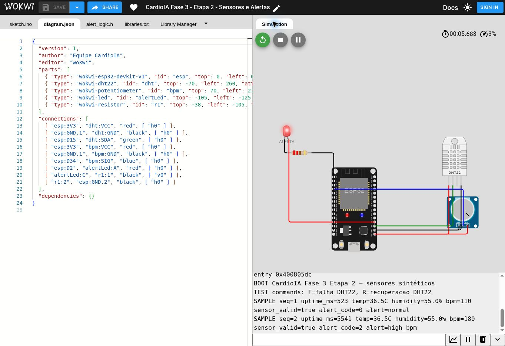
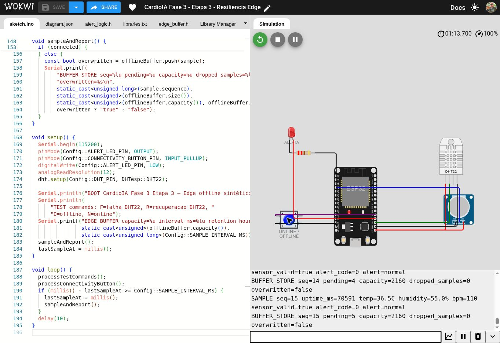
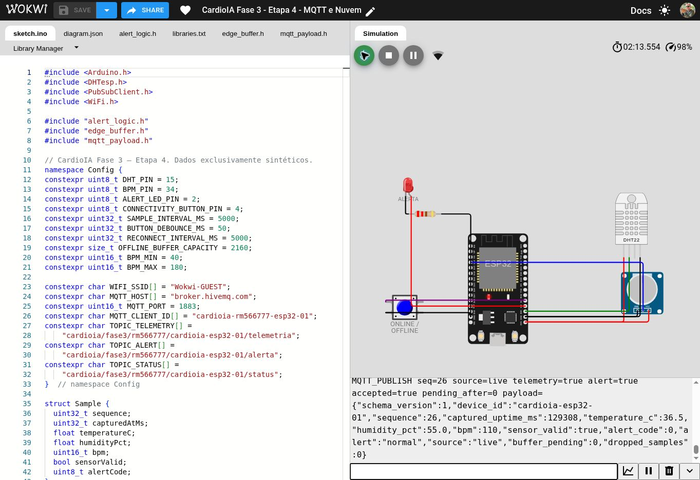

# CardioIA — Parte 1: armazenamento e processamento local

## Identificação

**Curso:** Tecnologia em Inteligência Artificial — FIAP  
**Fase:** 3 — Monitoramento Contínuo: IoT na Saúde  
**Projeto:** CardioIA — protótipo educacional com dados sintéticos  
**Data do relatório:** 25/10/2026

| Integrante | RM |
|---|---|
| Fabrício Mouzer Brito | RM566777 |
| Enzo Nunes Castanheira Gloria da Silva | RM567599 |
| Larissa Nunes Moreira Reis | RM568280 |
| Gabriel Rapozo Guimarães Soares | RM568480 |

## 1. Objetivo

Esta parte do projeto demonstra o papel do Edge Computing no monitoramento
contínuo de sinais vitais. Um ESP32 simulado no Wokwi coleta temperatura e
umidade do DHT22 e converte a leitura analógica de um potenciômetro em uma faixa
sintética de 40 a 180 batimentos por minuto. O processamento local classifica o
estado da amostra, aciona um LED de alerta e mantém a coleta mesmo quando a
conectividade simulada fica indisponível.

O protótipo utiliza somente dados sintéticos. Ele não diagnostica doenças, não
substitui avaliação profissional e não deve receber informações reais de
pacientes.

## 2. Circuito e sensores

O circuito contém um ESP32 DevKit, um DHT22 no GPIO 15, um potenciômetro no ADC
GPIO 34, um LED vermelho com resistor de 220 ohms no GPIO 2 e um botão no GPIO 4.
O DHT22 constitui o sensor obrigatório e fornece temperatura e umidade. O
potenciômetro representa o segundo sensor e permite variar o BPM sintético de
forma reproduzível durante os testes.

A coleta ocorre nominalmente a cada 5.000 ms. O código usa `millis()` e evita
pausas longas que interromperiam os serviços de rede. A variação observada ao
redor da cadência nominal decorre do tempo de leitura, iterações do loop e
agendamento do simulador. Na validação da Etapa 2, 5.018 ms representaram apenas
18 ms ou 0,36% acima do valor nominal, dentro da tolerância definida de 5.000 a
5.050 ms.

## 3. Processamento local e alertas

Cada amostra recebe número de sequência, instante desde a inicialização, valores
dos sensores, validade do DHT22 e máscara de alerta. O estado permanece normal
entre 50 e 120 BPM, inclusive, e com temperatura de até 38,0 °C, inclusive. O
firmware sinaliza BPM baixo, BPM alto, temperatura alta e falha do sensor.

As regras ficam no próprio ESP32. Essa decisão permite reação local mesmo sem
acesso à nuvem. O LED acende quando existe qualquer alerta e apaga após a
recuperação. Os testes comprovaram transições contínuas de normal para alerta e
de alerta para normal sem reiniciar o dispositivo.

Quando o DHT22 fica inválido, o payload usa `-999.0` para temperatura e `-1.0`
para umidade, define `sensor_valid=false` e ativa o bit 3 (valor 8 na máscara
`alert_code`). Esses valores sentinela tornam a falha explícita e impedem que
uma leitura ausente pareça uma medição clínica válida.

| Bit | Valor (`alert_code`) | Constante C++ | Condição Clínica / Técnica |
|---:|---:|---|---|
| — | `0` | `ALERT_NONE` | Estado normal (`50 <= BPM <= 120` e `temp <= 38,0 °C`) |
| 0 | `1` | `ALERT_BPM_LOW` | Bradicardia sintética (`BPM < 50`) |
| 1 | `2` | `ALERT_BPM_HIGH` | Taquicardia sintética (`BPM > 120`) |
| 2 | `4` | `ALERT_TEMP_HIGH` | Hipertermia sintética (`temperatura > 38,0 °C`) |
| 3 | `8` | `ALERT_SENSOR_ERROR` | Falha de leitura do sensor `DHT22` (`sensor_valid=false`) |

## 4. Resiliência offline

O ESP32 utiliza um buffer circular FIFO em RAM (`EdgeBuffer<Sample, 2160>`) com
capacidade para 2.160 amostras. Como cada estrutura `Sample` possui exatamente
20 bytes (`static_assert(sizeof(Sample) == 20)`), o buffer consome 43.200 bytes
(43,2 KB) de SRAM de forma estática e previsível, sem alocação dinâmica no heap.
Com uma leitura a cada cinco segundos, o limite representa três horas de
operação contínua sem conexão. Quando o buffer atinge a capacidade máxima, a
amostra mais antiga é substituída e `dropped_samples` aumenta. Essa política
preserva as leituras recentes e expõe qualquer perda.

Quando Wi-Fi ou MQTT não está disponível, a coleta continua e cada amostra entra
na fila. Após a reconexão, o firmware publica as pendências na ordem original e
remove cada item somente depois que `publish()` confirma a aceitação local. As
novas leituras ao vivo retornam depois que o FIFO chega a zero.

O armazenamento em RAM é volátil e se perde quando a simulação é encerrada. O
enunciado reconhece a limitação de SPIFFS em simuladores. Em hardware real, a
arquitetura poderia usar flash ou cartão microSD com política de desgaste,
criptografia e retenção adequada.

## 5. Validação executada

Na execução integrada A, o sistema começou normal em 110 BPM, detectou 163 BPM
como alerta alto e retornou ao normal sem reinício. A conectividade foi então
desativada. As sequências 12 a 20 formaram uma fila de nove amostras. Após a
reconexão, o firmware publicou as nove sequências em ordem, reduziu o contador de
pendências de 8 até 0 e registrou `SYNC_DONE sent=9 pending=0
dropped_samples=0`.

Na execução B, uma nova inicialização começou novamente em `sequence=1`. O
sistema classificou 42 BPM como baixo, registrou falha controlada do DHT22 nas
sequências 10 a 13 e recuperou o estado normal na sequência 14 sem reinício. Os
valores de fronteira 50 BPM, 120 BPM e 38,0 °C permaneceram normais, conforme as
regras documentadas.

Testes unitários adicionais reduziram a capacidade do buffer para provocar
estouro de forma determinística. Eles confirmaram a substituição da amostra mais
antiga e o incremento do contador de descartes. A execução principal terminou
com fila zero e nenhum descarte.

### Capturas da simulação no Wokwi (Edge Computing e Resiliência)

| Circuito Wokwi em Estado Normal | Circuito Wokwi com LED de Alerta Ativado |
|---|---|
|  |  |
| **Coleta Offline e Armazenamento no Buffer FIFO (`BUFFER_STORE`)** | **Sincronização Serial/MQTT Concluída Após Reconexão** |
|  |  |

## 6. Limitações, segurança e evolução

O potenciômetro não mede batimentos cardíacos reais. Ele gera valores sintéticos
para validar o fluxo. O buffer em RAM não sobrevive a reinicializações. O botão
e os comandos seriais `O`, `N`, `F` e `R` existem para produzir cenários
repetíveis no ambiente educacional.

Uma versão clínica exigiria sensores certificados, armazenamento persistente,
controle de qualidade do sinal, sincronização temporal, criptografia, gestão de
identidade, consentimento e validação regulatória. Os limites usados no
protótipo são regras didáticas e não recomendações médicas.

## 7. Conclusão

A Parte 1 comprovou coleta periódica com dois sensores, processamento local,
alertas, continuidade offline, armazenamento limitado e sincronização ordenada.
O desenho torna perdas observáveis e mantém o comportamento reproduzível. As
evidências públicas incluem código comentado, circuito, logs, capturas e testes
automatizados.

## Links

- Wokwi: <https://wokwi.com/projects/478851580032675841>
- Repositório: <https://github.com/FabricioMouzer/CardioIA-Fase3-Monitoramento-IoT>
- Evidências da Etapa 6: <https://github.com/FabricioMouzer/CardioIA-Fase3-Monitoramento-IoT/tree/main/evidencias/etapa-6>

