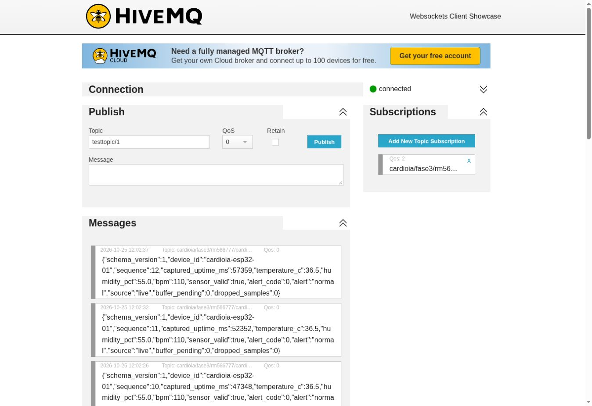
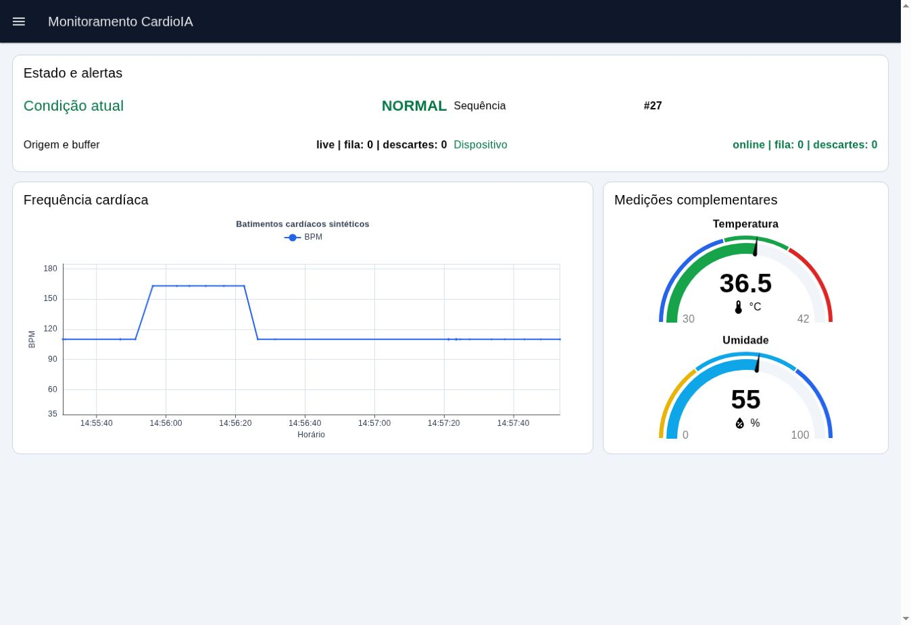
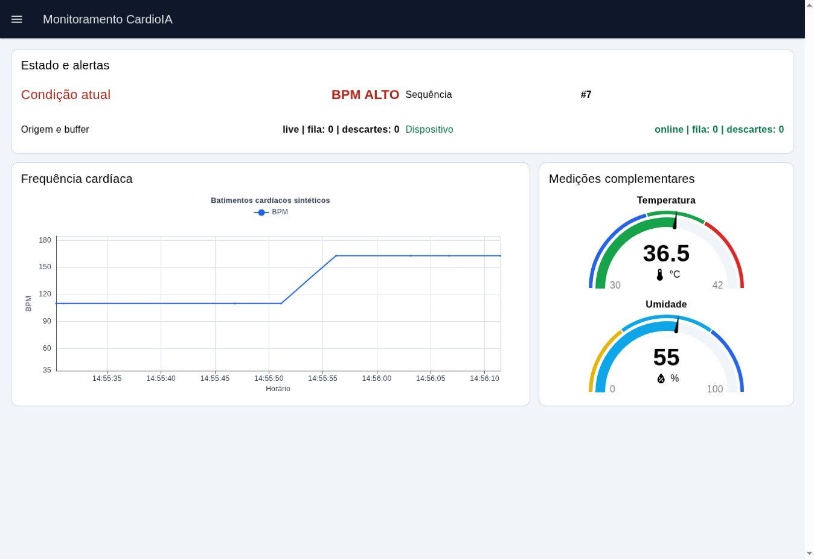
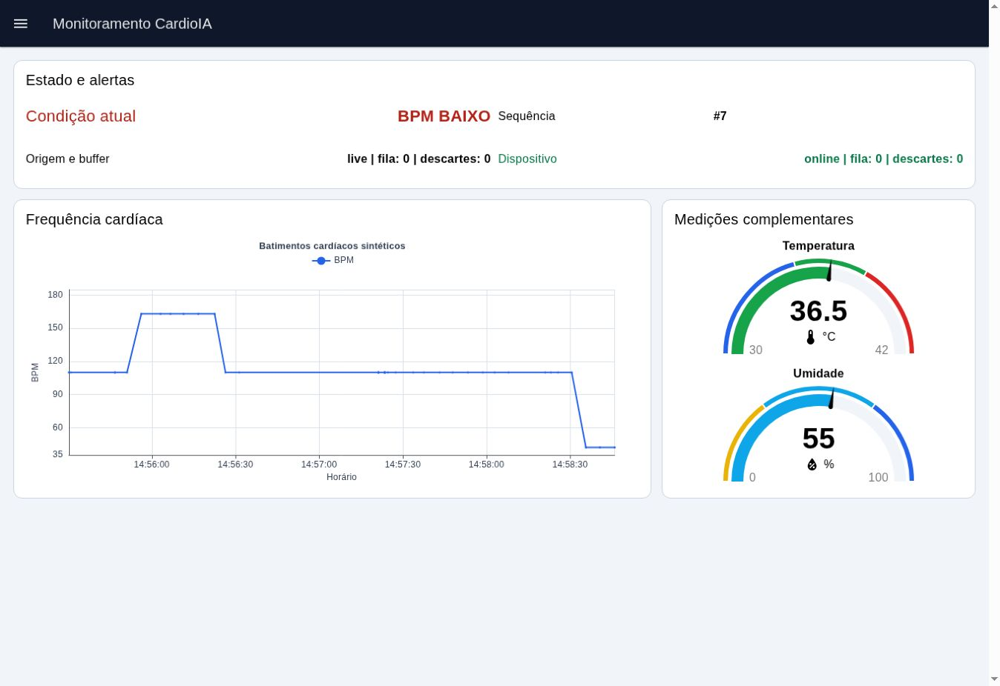
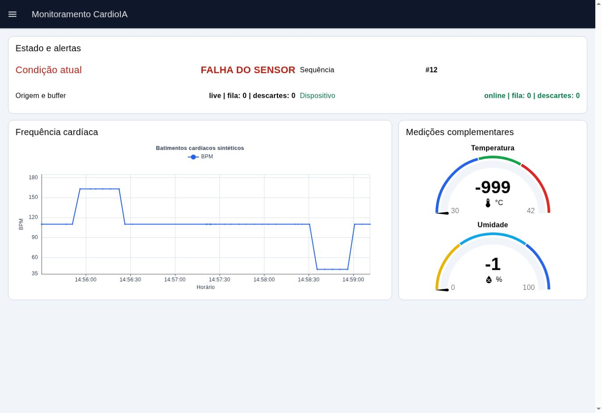

# CardioIA — Parte 2: MQTT, nuvem e dashboard

## Identificação

**Curso:** Tecnologia em Inteligência Artificial — FIAP  
**Fase:** 3 — Monitoramento Contínuo: IoT na Saúde  
**Projeto:** CardioIA — protótipo educacional com dados sintéticos  
**Data do relatório:** 25/10/2026

| Integrante | RM |
|---|---|
| Fabrício Mouzer Brito | RM566777 |
| Enzo Nunes Castanheira Gloria da Silva | RM567599 |
| Larissa Nunes Moreira Reis | RM568280 |
| Gabriel Rapozo Guimarães Soares | RM568480 |

## 1. Objetivo e arquitetura

A Parte 2 integra o ESP32 simulado ao broker MQTT e ao dashboard Node-RED. O
fluxo começa nos sensores sintéticos, passa pelo processamento Edge e pelo
buffer offline, publica mensagens no HiveMQ, valida o contrato no Node-RED e
apresenta valores e alertas no FlowFuse Dashboard 2.0.

O ESP32 usa a rede `Wokwi-GUEST` e publica no broker público
`broker.hivemq.com`, porta 1883. O Node-RED 5.0.9 e o
`@flowfuse/node-red-dashboard` 1.34.0 executam em um serviço público no Render.
O editor administrativo fica desabilitado nesse ambiente e somente o dashboard
é exposto.

## 2. Contrato de comunicação

O namespace inclui fase, RM e identificador do dispositivo para reduzir colisões:

```text
cardioia/fase3/rm566777/cardioia-esp32-01/telemetria
cardioia/fase3/rm566777/cardioia-esp32-01/alerta
cardioia/fase3/rm566777/cardioia-esp32-01/status
```

Telemetria e alerta não usam retenção. O status usa retenção para que novos
assinantes visualizem o último estado conhecido. O ESP32 também configura Last
Will `offline_unexpected`. O protótipo usa QoS 0, coerente com a demonstração,
mas reconhece que essa modalidade não garante entrega.

O payload de telemetria contém 13 campos: versão do esquema, dispositivo,
sequência, instante da coleta, temperatura, umidade, BPM, validade do sensor,
código e rótulo do alerta, origem, pendências e descartes. `schema_version=1`
permite rejeitar mensagens incompatíveis. A sequência crescente apoia detecção
de duplicidades, perdas e correlação ponta a ponta.

## 3. Publicação e reconexão

O firmware atende a rede sem bloquear a coleta. Quando Wi-Fi ou MQTT cai, uma
tentativa de reconexão ocorre no máximo a cada cinco segundos. Enquanto isso, as
amostras permanecem no FIFO. Após reconectar, o estado muda para
`online_syncing`, as pendências são publicadas como `source=buffered` e o estado
retorna a `online` quando a fila termina.

Uma amostra só sai da fila depois que o cliente MQTT aceita localmente a
publicação da telemetria e, quando aplicável, do alerta. Esse retorno não prova
entrega pela rede. Por isso, a Etapa 4 usou um assinante WebSocket independente
para confirmar o recebimento no broker.

## 4. Fog Computing e validação no Node-RED

O Node-RED atua como camada Fog. Ele assina os três tópicos, converte o payload,
verifica os campos obrigatórios e impede que dados incompatíveis cheguem aos
widgets. O flow rejeita JSON inválido, esquema diferente de 1, identificador
inesperado, valores não numéricos e enumerações não reconhecidas.

O flow exportado fica em `node-red/flows.json`. As versões do runtime estão
fixadas no `package-lock.json`, permitindo reconstrução com `npm ci`. Botões de
injeção determinística reproduzem estados normal, BPM alto, BPM baixo,
temperatura alta, falha do sensor, fronteiras e contrato incompatível. Esses
botões servem apenas aos testes.

## 5. Dashboard e alertas

O dashboard apresenta um gráfico temporal de BPM (`ui-chart`), gauge de
temperatura (`ui-gauge`), gauge de umidade (`ui-gauge`), condição atual
(`ui-text`), sequência, origem, fila, descartes e estado do dispositivo. A
escolha visual prioriza o gráfico de linha em série temporal para os batimentos
cardíacos (variável hemodinâmica de oscilação rápida) e medidores tipo *gauge*
com faixas cromáticas para temperatura (30 a 42 °C) e umidade (0 a 100%), cujas
variações ocorrem de forma gradual. O indicador visual de condição muda
automaticamente a cor (`#067647` verde em estado normal para `#b42318` vermelho
em alerta) e o rótulo para `BPM BAIXO`, `BPM ALTO`, `TEMPERATURA ALTA` ou
`FALHA DO SENSOR` conforme a máscara calculada no Edge.

Os cenários observados incluíram 163 BPM com alerta alto, 42 BPM com alerta
baixo, 39,5 °C com temperatura alta e DHT22 inválido com alerta técnico. O
retorno a 110 BPM e 36,5 °C restaurou o estado normal sem reiniciar a simulação.
Os valores exatamente nos limites, 50 BPM, 120 BPM e 38,0 °C, permaneceram
normais.

## 6. Testes ponta a ponta

A validação integrada executou duas simulações independentes. A execução A
comprovou alerta alto, retorno ao normal, nove amostras offline e sincronização
FIFO completa. A execução B comprovou alerta baixo, falha e recuperação do
DHT22, além das três fronteiras.

O validador da Etapa 6 executou 38 verificações sobre logs e capturas. A
regressão também aprovou 35 verificações da Etapa 5, 20 verificações de evidência
MQTT, 20 testes estruturais, 23 verificações do FIFO e oito cenários da lógica
de alerta. O Wokwi e o dashboard responderam HTTP 200. O editor administrativo
do Render respondeu HTTP 404, conforme a configuração de segurança.

### Capturas do broker MQTT e do dashboard Node-RED

| Recebimento no Broker HiveMQ (Assinante Independente) | Dashboard em Estado `NORMAL` (Gráfico BPM + Gauges + Fila Zero) |
|---|---|
|  |  |
| **Alerta Visual Automático — `BPM ALTO` (163 BPM)** | **Alerta Visual Automático — `BPM BAIXO` (42 BPM)** |
|  |  |

| Alerta Técnico Automático — `FALHA DO SENSOR` (`DHT22` inválido) |
|---|
|  |

## 7. Segurança e limitações

O HiveMQ público e a porta 1883 não oferecem autenticação nem TLS. Essa escolha
serve somente ao protótipo acadêmico com dados sintéticos. Nenhum nome de
paciente, e-mail, senha, token ou dado clínico real integra o payload.

Uma auditoria de dependências atualizou `body-parser` para 1.20.9 e `multer`
para 2.5.0 por meio de `overrides`. Permanecem alertas transitivos dentro do
pacote `npm` embarcado no registro administrativo do Node-RED. O ambiente do
Render desabilita todos os endpoints administrativos com `httpAdminRoot=false`
e bloqueia instalação e upload dinâmicos de módulos. O grupo deve revisar esses
alertas quando o Node-RED publicar uma atualização compatível.

Em produção, o sistema precisaria de TLS, credenciais individuais, autorização
por tópico, rotação de segredos, auditoria, criptografia em repouso, alta
disponibilidade e observabilidade. O plano gratuito do Render pode suspender a
instância após inatividade e aumentar o tempo do primeiro acesso.

QoS 0 e a confirmação local de `publish()` não garantem exatamente uma entrega.
Uma evolução poderia adotar QoS 1, identificadores idempotentes e persistência
no dispositivo e no servidor. Também seria necessário validar sensores e
limites clínicos com profissionais e normas aplicáveis.

## 8. Reprodutibilidade

O repositório público contém código C++, circuito, bibliotecas, flow Node-RED,
dependências fixadas, contrato JSON, exemplos, logs, capturas e testes. O projeto
do Wokwi abre sem login. O dashboard abre em navegador comum e a raiz
administrativa não fica disponível no ambiente público.

Como o broker é público e o protótipo usa um namespace compartilhado, a
demonstração deve manter somente uma simulação do Wokwi ativa por vez. Isso
evita colisão do identificador MQTT e sobreposição de sequências.

Para execução local do dashboard, basta entrar em `node-red`, executar `npm ci`
e depois `npm start`. O Wokwi compila o firmware usando `DHT sensor library for
ESPx` e `PubSubClient`.

## 9. Conclusão

A Parte 2 comprovou transmissão MQTT, recebimento independente, reconexão,
validação Fog, visualização em tempo real e alertas automáticos. A arquitetura
também apresenta suas limitações de forma explícita e mantém rastreabilidade
entre requisito, código, teste e evidência.

## Links

- Dashboard: <https://cardioia-fase3-dashboard.onrender.com/dashboard/monitoramento>
- Wokwi: <https://wokwi.com/projects/478851580032675841>
- Repositório: <https://github.com/FabricioMouzer/CardioIA-Fase3-Monitoramento-IoT>
- Flow Node-RED: <https://github.com/FabricioMouzer/CardioIA-Fase3-Monitoramento-IoT/blob/main/node-red/flows.json>
- Validação integrada: <https://github.com/FabricioMouzer/CardioIA-Fase3-Monitoramento-IoT/blob/main/docs/ETAPA_6_VALIDACAO.md>

