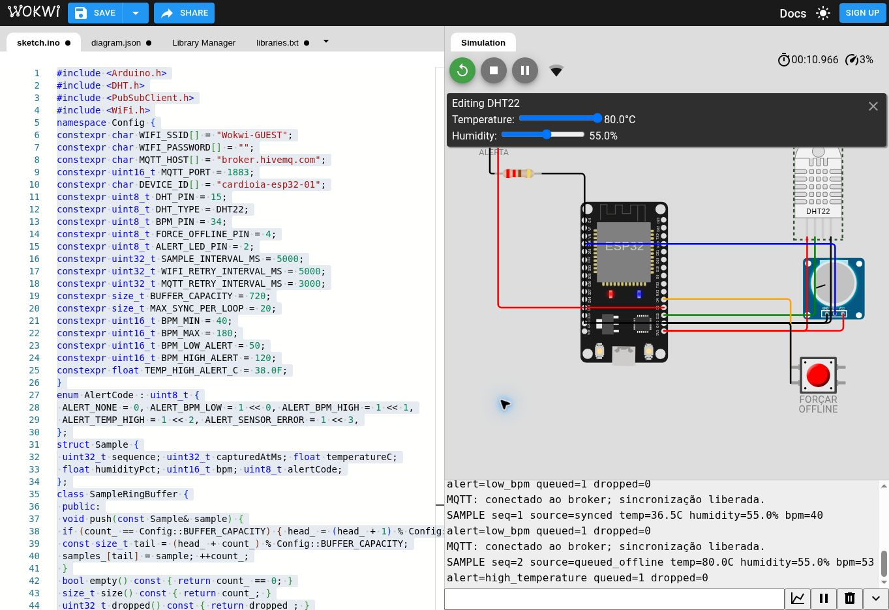
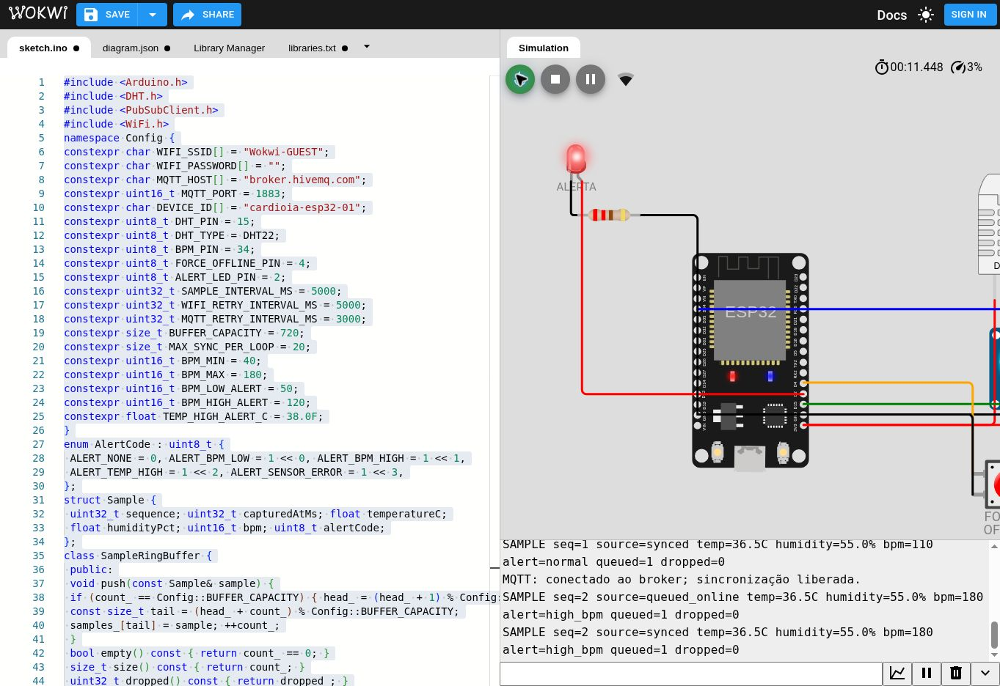

# Etapa 1 — validação preliminar do circuito e firmware
Data: 23/10/2026. PR #10. Branch: `feat/cardioia-fase3-iot`.
Commit inspecionado: `8fc45fd6d1b4c8f75e50dc6eb31e234bade03a2b`.

## Decisão
**ETAPA AINDA NÃO APROVADA. Node-RED não autorizado por este resultado.**
O ensaio produziu evidências reais de execução no simulador, mas ainda não fecha todos os critérios abaixo. A PR deve permanecer aberta e em rascunho.

## Escopo e rastreabilidade
Foram lidos todos os arquivos textuais da pasta `fase-3/cardioia-monitoramento-continuo`, a árvore da branch e os metadados da PR. Não foi encontrado AGENTS.md na árvore.
O circuito foi transferido para o editor ESP32 do Wokwi; bibliotecas: DHT sensor library, Adafruit Unified Sensor e PubSubClient.
A cópia do sketch transferida ao navegador foi compactada manualmente: comentários/espaços e algumas chaves opcionais foram removidos. O arquivo efetivamente ensaiado está em [sketch-ensaio-preliminar.ino](evidencias/2026-10-23/sketch-ensaio-preliminar.ino).
Uma comparação lexical confirmou os mesmos tokens após excluir comentários, espaços e chaves; **isso não substitui comparação byte a byte nem prova formal de equivalência**. Portanto não se atribui a compilação desta cópia à versão exata da branch.
Nenhum firmware oficial, circuito ou flow Node-RED foi alterado.

SHA256 do sketch original: `9d7a0a12b98cec0ec1081f919cc12546a69b5be87110799cc8b5a2f5657797c8`.
SHA256 da cópia ensaiada: `7c7f141dcdf424a0bdc7f4ab1ccf34f190cabaa73de397d35c7cfc3cf63552a0`.

## Configuração conferida
| Elemento | Circuito | Firmware |
|---|---|---|
| DHT22 | SDA em D15; VCC 3V3; GND | GPIO15, DHT22 |
| Potenciômetro | SIG D34; VCC 3V3; GND | GPIO34, ADC 12 bits, mapeamento 40–180 BPM |
| Botão offline | D4 e GND, terminais 1.l e 2.l | GPIO4, INPUT_PULLUP; pressionado = offline |
| LED | D2 → anodo; catodo → resistor 220 ohms → GND | GPIO2, HIGH em alerta |
| Serial | monitor do Wokwi | 115200 baud |
| Amostragem | — | intervalo nominal 5000 ms |
| Rede | gateway público do Wokwi | Wokwi-GUEST, canal 6; HiveMQ:1883 |
| Buffer | RAM | 720 amostras, FIFO, substitui mais antiga ao lotar |

As ligações correspondem aos pinos configurados. Conferência de arquivo não equivale a validação elétrica em hardware físico.
PlatformIO/arduino-cli/wokwi-cli não estavam instalados; compilação PlatformIO não foi executada. O ensaio usou o compilador do Wokwi online. Versões exatas das bibliotecas resolvidas online não foram capturadas.

## Resultados observados no Wokwi
| Cenário | Observação | Evidência |
|---|---|---|
| Compilação da cópia | Simulador iniciou, sem erro de compilação exibido | boot e execução do firmware |
| Inicialização | Mensagem CardioIA e primeira coleta | trechos Serial abaixo |
| Normal | 36,5 °C, 55%, 110 BPM, alert=normal | seq=1 |
| BPM alto | Potenciômetro 1023; 180 BPM, high_bpm; LED vermelho aceso | seq=2 e captura |
| BPM baixo | Após reinício, potenciômetro 0; 40 BPM, low_bpm | seq=1 do segundo ensaio |
| Temperatura alta | DHT22 ajustado ao máximo de 80 °C; 53 BPM; high_temperature | seq=2 do segundo ensaio; captura e log |
| Falha do DHT22 | Não executada no simulador | pendente |
| Retorno ao normal | Não validado após alerta | pendente |
| Cadência e continuidade prolongada | Não aferidas | pendente |

A simulação rodou a aproximadamente 3% da velocidade normal: segundos de simulação não são segundos de relógio.
No primeiro ensaio:
```text
CardioIA Fase 3 iniciado — dados exclusivamente sintéticos.
WIFI: tentativa de conexão iniciada.
SAMPLE seq=1 source=queued_offline temp=36.5C humidity=55.0% bpm=110 alert=normal queued=1 dropped=0
MQTT: conectado ao broker; sincronização liberada.
SAMPLE seq=1 source=synced temp=36.5C humidity=55.0% bpm=110 alert=normal queued=1 dropped=0
MQTT: conectado ao broker; sincronização liberada.
SAMPLE seq=2 source=queued_online temp=36.5C humidity=55.0% bpm=180 alert=high_bpm queued=1 dropped=0
SAMPLE seq=2 source=synced temp=36.5C humidity=55.0% bpm=180 alert=high_bpm queued=1 dropped=0
```
No segundo ensaio, [log Serial completo capturado](evidencias/2026-10-23/serial-segundo-ensaio.txt):
```text
SAMPLE seq=1 source=queued_offline temp=36.5C humidity=55.0% bpm=40 alert=low_bpm queued=1 dropped=0
SAMPLE seq=2 source=queued_offline temp=80.0C humidity=55.0% bpm=53 alert=high_temperature queued=1 dropped=0
```
80 °C foi um teste de extremo do simulador, não um cenário clínico. Não substitui o teste de fronteira em 38/38,1 °C.





O log MQTT comprova apenas conexão reportada pelo cliente e aceitação local da publicação. Não foi usado assinante independente. QoS 0 não confirma entrega fim a fim. A amostra de boot enfileirada e depois publicada **não comprova** o cenário de interrupção prolongada com botão offline.

## Testes locais reproduzíveis
Na pasta do projeto:
```sh
python -m unittest discover -s tests -v
python tests/run_firmware_logic.py
```
Requisitos do segundo comando: Python 3 e g++ no PATH.
Resultado observado: **6/6 testes estruturais aprovados**; oito cenários da função original calculateAlert aprovados (normal, limites 50/120 BPM e 38 °C, baixo, alto, temperatura elevada, sensor inválido e alerta combinado); buffer vazio, pop vazio, 721 inserções, capacidade 720, um descarte e ordem FIFO aprovados.
O teste nativo extrai trechos do próprio sketch, compila em C++11 e executa asserts. Não simula ADC, DHT22, GPIO, temporização, Wi-Fi, MQTT ou ESP32.

## Achados e pendências
1. README descreve tópicos com `rm566777`; sketch e flow oficiais usam tópicos sem esse prefixo. Os testes estruturais passam porque verificam a versão sem prefixo. Reconciliar o contrato antes da etapa MQTT.
2. Há arquivos na raiz com nomes longos em base64 e conteúdo duplicado. Não foram removidos; o ensaio tomou a pasta oficial da Fase 3 como referência.
3. `alertLabel` retorna o alerta prioritário (sensor > temperatura > BPM alto > BPM baixo). Alertas combinados são representados por bits em alert_code; o rótulo multiple_alerts não é atingido pelas combinações atuais. Isso é coerente com a arquitetura que descreve um rótulo prioritário.
4. Não foi observado erro de compilação da cópia nem falha nas leituras dos cenários normal/alto/baixo. Não há correção funcional justificada por esses resultados.
5. O salvamento como projeto público Wokwi foi tentado e bloqueado pela revisão automática de aprovação por falta de autorização explícita de publicação nesse serviço. Nenhum link público foi criado. A simulação sem publicação pôde continuar.

## Critérios para aprovar e liberar a próxima etapa
- [ ] Compilar e executar os **arquivos exatos** da branch; registrar SHA do sketch, circuito e versões resolvidas.
- [ ] Guardar projeto reproduzível (link salvo quando autorizado) e logs completos por cenário.
- [ ] Confirmar inicialização, sequência crescente, temperatura/umidade válidas e variação do potenciômetro.
- [ ] Demonstrar normal, BPM baixo e alto, temperatura >38 °C e limites 50/120 BPM/38 °C.
- [ ] Demonstrar LED ligado em alerta e desligado após retorno ao normal.
- [ ] Demonstrar falha de leitura DHT22 com alerta técnico, sem falha do programa.
- [ ] Observar coleta em várias amostras sem reinicialização; medir cadência sem confundir tempo simulado com real.
- [ ] Registrar revisão dos resultados e confirmação explícita de conclusão da etapa.

Após esses critérios, avaliar a etapa offline/MQTT conforme o plano do trabalho; só então avançar à integração com Node-RED. Nenhum dashboard foi importado, instalado ou executado nesta rodada.
